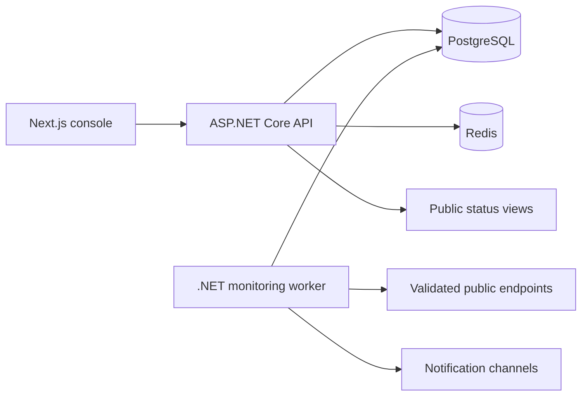
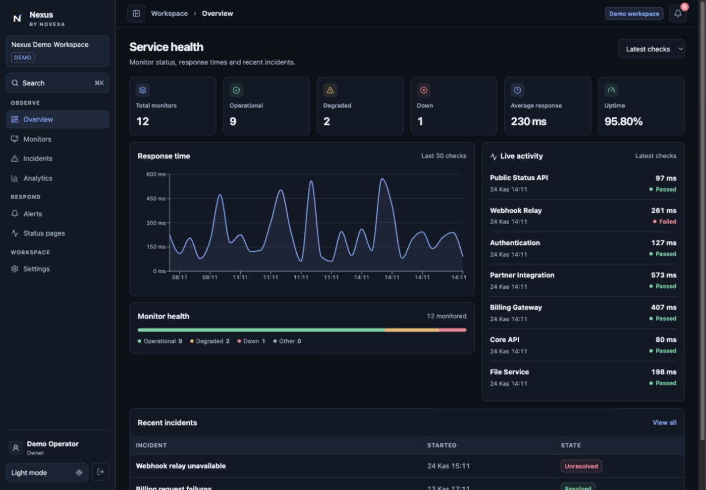

# Nexus by NOVEXA

**Know your APIs. Before your users do.**

Nexus brings API monitoring, performance analysis, incident response and external status communication into a multi-tenant workspace.

| Capability | What it covers |
|---|---|
| API monitoring | Scheduled and manual HTTP checks, response assertions, timeouts, retry policies, DNS timing and TLS expiry |
| Performance analytics | Uptime, error rates, latency percentiles, response distributions, monitor comparison and CSV export |
| Incident management | Automatic and manual incidents, severity, investigation timelines, recovery and root-cause notes |
| Alerting and notifications | In-app delivery, SMTP and webhook channels, delivery history and configuration status |
| Public status pages | Selected services, availability summaries and published incident history |
| Multi-tenant administration | Organization-scoped data, authentication, team roles, scoped API keys and audit history |

## Architecture

The backend is a modular monolith with separate API and worker processes. Authentication uses hashed passwords, short-lived JWTs and rotating refresh tokens. Role-based access controls and tenant-scoped queries restrict workspace data. Monitoring applies outbound target validation and DNS pinning.

**Stack:** C#, .NET, ASP.NET Core, Entity Framework Core, Next.js, TypeScript, PostgreSQL, Redis, SignalR and Docker.

## Screenshot gallery

These captures show the local demo workspace and its synthetic history.

- [Light mode overview](assets/screenshots/dashboard-light.png) · [Mobile dashboard](assets/screenshots/mobile-dashboard.png)
- [Monitor inventory](assets/screenshots/monitors.png) · [Monitor detail](assets/screenshots/monitor-detail.png)
- [Analytics](assets/screenshots/analytics.png) · [Incidents](assets/screenshots/incidents.png)
- [Alert channels](assets/screenshots/alerts.png) · [Public status page](assets/screenshots/status-page.png)
- [Workspace settings](assets/screenshots/settings.png)

## Project status

Nexus is a working product with a local demonstration workspace. This repository is its public product portfolio. The application source code is proprietary. No open-source license is granted.

[NOVEXA](https://novexxa.dev)
